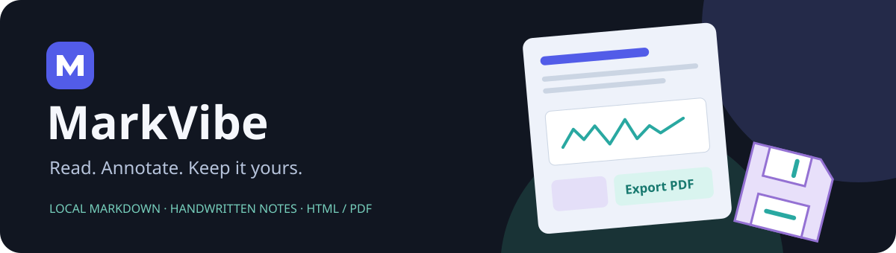

# MarkVibe



**A local Markdown reader with handwritten notes and portable HTML/PDF export.**

[Download Windows packages](https://github.com/umbertotechnopreneur/MarkVibe/releases) ·
[MIT license](LICENSE) · [My website](https://umbertogiacobbi.biz) ·
[VibeWare manifesto](https://umbertogiacobbi.biz/vibeware/manifesto)

## Why I created it

I was frustrated by the Markdown readers I tried. Reading was usually easy; writing
a note, keeping it with the document, or exporting a useful PDF or HTML file was less
straightforward. I kept running into extra converters, awkward export steps or apps
built around an operating system I was not using.

I wanted something for my own workflow: open local documentation, move between
connected pages, write a handwritten note, and save a copy I can share. So I created
MarkVibe. I keep the Markdown intact and store handwriting in a separate file. I use
the same document rendering for reading and exporting, with local images and diagrams
included in the result.

## What I built

| Capability | What you can do |
| --- | --- |
| Local documents | Open Markdown files, folders or documentation ZIPs; follow relative links and images |
| Four views | Read, inspect read-only source with Monaco, compare in Split, or explore the document map |
| Handwritten notes | Add a note to a paragraph with pen or mouse; use pressure samples, highlighter, eraser and undo/redo |
| Separate ink | Keep metadata and strokes in `document.md.ink.json`; Windows autosaves beside the Markdown |
| HTML and PDF | Export the current page with embedded images, diagrams and resolved vector ink; Windows saves PDF directly |
| Appearance | Use OpenSilver Modern Theme in Light, Dark or System mode, reading styles and zoom |
| Pick up later | Remember the last document, path and reading position; turn remembering off in settings |

The document stays on your device. I have added no document-upload backend.
Markdown source is currently read-only; handwriting is the writing feature.
Exports cover the current page. Changed documents and conflicting sidecars require
review rather than silently overwriting your notes.

## Get started on Windows

I provide Windows 11 packages for **x64 and ARM64**:

- **MSIX bundle:** chooses the architecture automatically and adds MarkVibe to Start.
- **Portable ZIP:** extract the matching architecture to a writable folder and open
  `MarkVibe.Windows.exe`. Settings and the last document stay in its `data/` folder.

Both include the .NET runtime. Microsoft Edge WebView2 Runtime is required.
Initial packages are development-signed: use their supplied public certificate and
installation instructions. Store publication is a later decision.
See [Windows packaging and installation](docs/windows-packaging.md).

Open a file or folder, then choose **Annotate → Handwritten note** under a paragraph.
Use **Settings → Export HTML / Export PDF** to save the current page.
The About window links to my website, this repository, the license and VibeWare.

The browser build also imports files/folders/ZIPs and downloads ink sidecars.
Browser PDF uses its print dialog; imported documents may need reselection after a
restart. I have not packaged macOS or Linux desktop wrappers.

## Build from source

Use .NET SDK **10.0.401**, Node **22.12 or later**, and an existing Windows SDK for MSIX:

```powershell
npm ci --ignore-scripts --no-audit --no-fund
npm run bundle
dotnet restore MarkVibe.slnx --locked-mode
dotnet build MarkVibe.slnx --no-restore
dotnet run --project src/MarkVibe.Windows --no-build
```

For the browser, run `dotnet run --project src/MarkVibe.Browser --no-build --launch-profile MarkVibe`
and open [localhost:5080](http://localhost:5080/).

To create distribution files:

```powershell
./scripts/package-windows.ps1 -Configuration Release
# Or: ./scripts/package-windows.ps1 -Configuration Debug
```

Each packaging build cleans repository `artifacts/`, advances the four-part version,
and produces the two architectures together. It does not run tests or install anything.
The manual **Windows MSIX and portable packages** GitHub workflow uploads the same
files as downloadable build artifacts. It does not publish a release automatically.

I use C#/OpenSilver for the application, Markdig for Markdown, Monaco for source,
Mermaid for diagrams and WPF/WebView2 for Windows. See [architecture](docs/architecture.md),
[ink](docs/ink-design.md), [settings](docs/settings.md) and [contributing](CONTRIBUTING.md).
Earlier local checks are recorded in [validation](docs/validation.md); they are
distinct from installation or hardware acceptance of each new package.

## Free software

I am **Umberto Giacobbi**, and I release MarkVibe under the **MIT license**. You may
use it for any purpose, change it, share it or sell it, while keeping the copyright
and license notice. Dependency licenses remain applicable.

---

**VibeWare** — Human intent, AI execution, and plenty of tokens.

Created by [Umberto Giacobbi](https://umbertogiacobbi.biz) ·
[Read my VibeWare manifesto](https://umbertogiacobbi.biz/vibeware/manifesto) ·
Copyright © 2026 Umberto Giacobbi · [MIT](LICENSE)