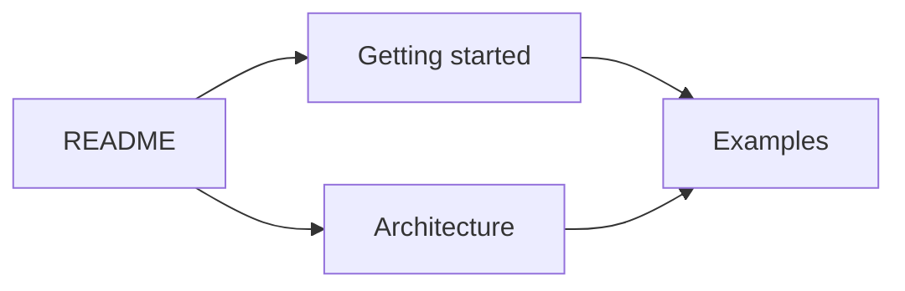

# MarkVibe

**A local Markdown reader with a document map, optional AI editing and HTML/PDF export.**

[Windows downloads](https://github.com/umbertotechnopreneur/MarkVibe/releases) ·
[MIT license](LICENSE) · [Build and installation](docs/windows-packaging.md)

## Why I built it

MarkVibe started as a quick weekend project. I was frustrated with the tools I
tried for reading Markdown: I did not want to launch Visual Studio Code, or even
a browser, just to read an MD file.

I also wanted something I could customize completely. As usual, I started writing
code. Having a small codebase of my own means I can make it behave exactly how I
want, without finding my way through a huge application first.

## What it does

- Opens local Markdown files, folders and documentation ZIPs, including relative
  links, images and Mermaid diagrams.
- Offers Read, read-only Source, Split and Map views, with themes and saved layout.
- Exports the current page as HTML or PDF with its images and diagrams.
- Optionally revises Markdown through OpenAI API or the installed Codex CLI,
  using an explicit prompt and selected reference documents. Edited Markdown can
  be saved as a separate copy.

Reading and navigation happen locally. Sending an AI request shares the prompt,
current document or selection, and collected references with OpenAI. A configured
API key also allows startup to fetch the available model list; that sends no
documents. Choose the connection in Settings and use its Test button for an
explicit pass/fail result. Codex CLI requires the Windows desktop host and an
existing CLI login. See [AI editing and data handling](docs/ai-editing.md).

## Follow the map

The map turns linked documents into cards. Search by title or path, explore nearby
pages or folders, inspect incoming and outgoing links, follow a route, and save a
viewpoint. Double-clicking a document card opens its page.

For example, a small documentation set might connect like this:



The current source also includes a relation lens, document comparison, navigation
trails and short directional link animations. See [map behavior and saved layouts](docs/map-layout.md).
Downloadable prereleases may predate the current source; GUI acceptance remains
with the maintainer.

## Run it

The desktop app targets **Windows 11, x64 and ARM64**. Windows packaging supports
MSIX, an MSI installer and a portable ZIP; check each release's actual assets.
The .NET runtime is included. Microsoft Edge WebView2 Runtime is required.
Development-signed MSIX packages include their own installation instructions.

The shared browser build runs through WebAssembly. Linux and macOS have no
dedicated desktop packages. The Windows app uses WebView2 internally, even though
it opens as its own application.

## Build it

I use **.NET 10 / C# / OpenSilver XAML**, with **WPF and WebView2** for Windows,
**Markdig** for Markdown, **Monaco** for source and **Mermaid** for diagrams.
The browser adapters use JavaScript modules; there is no Vue application.

With .NET SDK **10.0.402** and Node **22.12 or later**:

Open `MarkVibe.sln` in Visual Studio and choose the Desktop or Browser launch
profile to debug. The [Visual Studio guide](docs/visual-studio.md) explains setup,
the equivalent `.slnx` solution and the shared build/debug paths.

For the command line:

```powershell
npm ci --ignore-scripts --no-audit --no-fund
npm run bundle
dotnet restore MarkVibe.slnx --locked-mode
dotnet build MarkVibe.slnx --no-restore
dotnet run --project src/MarkVibe.Windows --no-build
```

See [architecture](docs/architecture.md), [packaging](docs/windows-packaging.md)
and [contributing](CONTRIBUTING.md). Changes are delivered through pull requests.
Packaging cleans `artifacts/` before creating a new distribution.

## License and development

I release my MarkVibe code under the [MIT license](LICENSE).
Dependencies and brand assets keep their own notices; the included ELK layout
module remains EPL-2.0. See [third-party notices](THIRD-PARTY-NOTICES.txt) and
[dependency licensing](docs/dependencies.md).

I develop MarkVibe with AI assistance under my direction. The
[development disclosure](AI-DEVELOPMENT-DISCLOSURE.md) and
[validation record](docs/validation.md) distinguish implementation, builds,
installation and functional checks.

---

<p align="right">
  <a href="https://umbertogiacobbi.biz/vibeware/manifesto">
    
  </a><br>
  <strong>VibeWare</strong><br>
  <em>Human intent, AI execution, and plenty of tokens</em>
</p>

### This is VibeWare · [Manifesto](https://umbertogiacobbi.biz/vibeware/manifesto)

This project participates in the **VibeWare initiative**, an open initiative for
developers who build useful software with AI under human direction. VibeWare is
not the application's author or publisher.

I am [Umberto Giacobbi](https://umbertogiacobbi.biz). I define this project's
purpose, guide its implementation, and remain responsible for checking
functionality, performance, and security. Each project keeps its own identity,
license, release status and validation evidence.

To learn what VibeWare means and why I created it, read the
[VibeWare manifesto](https://umbertogiacobbi.biz/vibeware/manifesto).

[MarkVibe on GitHub](https://github.com/umbertotechnopreneur/MarkVibe) ·
[VibeWare on GitHub](https://github.com/umbertotechnopreneur/VibeWare) ·
[umbertogiacobbi.biz](https://umbertogiacobbi.biz)

*You are welcome to explore, adapt and reuse the open-source VibeWare materials
under the project license — my contribution to the developer community.*

[Terms](https://umbertogiacobbi.biz/terms/) · [Privacy](https://umbertogiacobbi.biz/privacy/)
