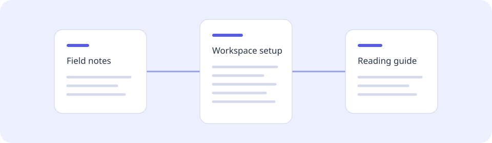

# Welcome to your reading space

A small collection of connected documents, ready to explore. Open **Read** for a calm page, **Source** to inspect the Markdown, **Split** to compare both on a wide screen, or **Map** to follow the relationships.

## Start here

- [Prepare a workspace](guide/setup.md#installation)
- [Find your reading rhythm](guide/reading.md)
- [Understand browser capabilities](reference/browser-notes.md)

## A few things to try

1. Switch between technical, editorial and compact presentation in settings.
2. Search for **folder** in the toolbar, or press **Ctrl+K**.
3. Open the document map and choose a connected page.
4. Follow a heading, go back and continue reading.

> These pages are synthetic examples. Your chosen local documents stay in this browser; the viewer has no document upload endpoint.

## A connected collection

~~~mermaid
flowchart LR
    A[Field notes] --> B[Workspace setup]
    A --> C[Reading guide]
    B --> D[Browser notes]
    C --> B
~~~

## A read-only workspace

- [x] Markdown pages
- [x] Relative links and images
- [x] Document outline and source view
- [ ] Future ink annotations

The sample annotation sidecar beside the setup guide illustrates a future file format. The current reader only reports its presence.
